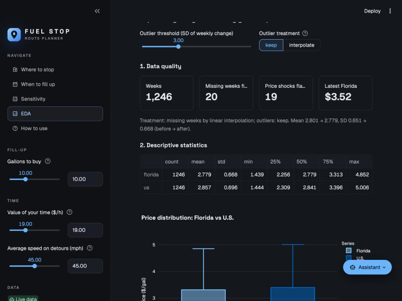
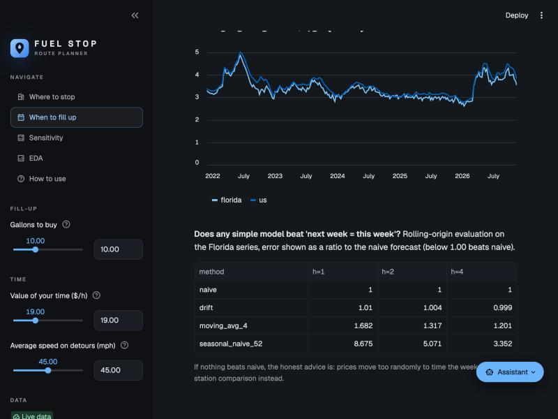
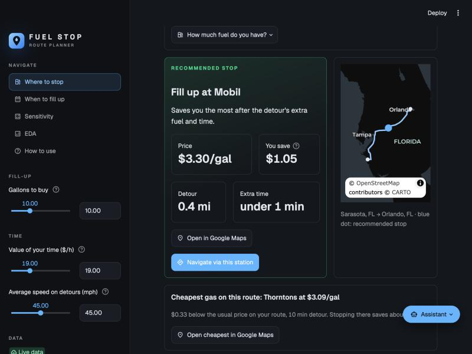
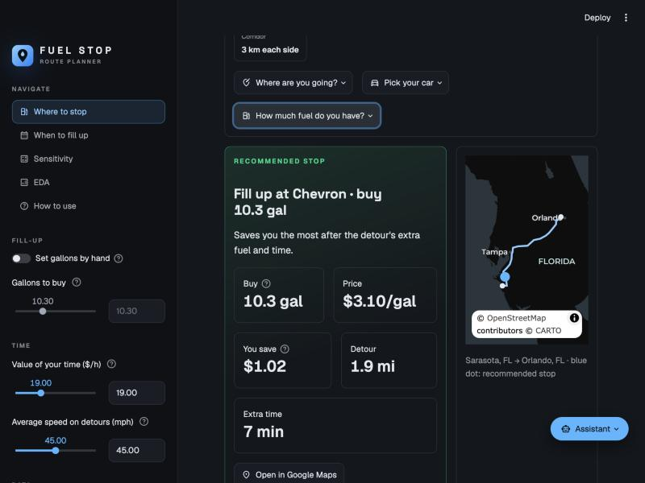

# Fuel Stop Planner — Project Report

**Programming for Data Science · Final Year-End Project**
Author: Gustavo Penna · Repository: https://github.com/gustavopennagiesb-ncf/fuel-stop-planner

> **TO FILL IN BEFORE SUBMITTING** — the two places marked `[...]` need your own words, and
> the "Team collaboration" section depends on whether this was approved as an individual
> project. Export this file to PDF or Word for the submission portal.

---

## 1. Objective

Drivers face two separate money questions and usually answer both by guessing: **when** to fill
up, and **where**. This project turns both into arithmetic the user can inspect.

The app answers three questions:

1. **Where should I stop on this route?** Not "which station is cheapest", but which one is
   cheapest *after* paying for the detour in fuel and time.
2. **Is this a good week to fill up?** Tested honestly against the naive forecast.
3. **Do I need to stop at all, and how much should I buy?** The driver says how much fuel is in
   the tank; the app works out whether the trip fits, which stations are still reachable, and
   how many gallons are worth buying at each.

A deliberate constraint shaped the whole design: **the language model never produces a number.**
Every figure on screen is computed in Python; the model only phrases what the code already
calculated, and a validator checks it.

## 2. Data sources

Four external APIs, all returning JSON over HTTPS. Retrieval and parsing live in `providers/`,
one module per API, with no UI code.

| Source | Endpoint | What is read |
|---|---|---|
| EIA Open Data API v2 | `GET /v2/petroleum/pri/gnd/data/` | weekly regular gasoline, Florida and U.S.: `period`, `value` |
| Google Places API (New) | `POST /v1/places:searchNearby` | station `id`, name, coordinates, `fuelOptions.fuelPrices[]` |
| Google Routes API v2 | `POST /directions/v2:computeRoutes` | `distanceMeters`, `duration`, `polyline.encodedPolyline` |
| fueleconomy.gov (EPA/DOE) | `GET /ws/rest/vehicle/...` | EPA label mpg: `city08`, `comb08`, `highway08`, `fuelType` |
| Groq (OpenAI-compatible) | `POST /openai/v1/chat/completions` | the explanatory text (no numbers trusted); free tier, used first |
| Anthropic Messages API | `POST /v1/messages` | the same, used when no Groq key is set |

The weekly EIA series is cached to `data/eia_weekly.csv` and reused when the API is unreachable.
Google responses are **never** written to disk: their terms allow storing only place IDs, which
is also why the synthetic test fixtures are generated rather than recorded.

The app runs in two modes. `fixture` needs no keys at all and generates synthetic data, clearly
labelled on screen; `google` uses the live APIs. Both Google calls send a field mask, so only
the fields above are requested and billed.

## 3. Exploratory data analysis



The Florida and U.S. weekly series cover **1,246 weeks** (2003 to 2026). The EDA tab reports the
cleaning rather than hiding it: **20 missing weeks** were filled by linear interpolation and
**19 price shocks** were flagged at a threshold the user can move (default: 3 standard
deviations of the weekly change). Outlier treatment is a choice offered to the user, "keep" or
"interpolate", because a price shock in gasoline is often a real event rather than an error.
The before/after means and standard deviations are printed so the effect of the treatment is
visible (mean 2.801 → 2.779, SD 0.651 → 0.668).

Weekly *changes* in Florida and U.S. prices correlate at **r = 0.799**, and the lead-lag analysis
puts the strongest link at **lag 0**: Florida moves with the national market in the same week,
not after it. That result matters for the forecasting question below, because it removes the
obvious candidate predictor.

## 4. Methodology and results

### 4.1 When to fill up: an honest negative result



Four methods were evaluated with **rolling-origin evaluation** against the naive forecast
("next week equals this week"), at horizons of 1, 2 and 4 weeks. Errors are reported as a ratio
to naive, so below 1.00 means better than naive.

| Method | h=1 | h=2 | h=4 |
|---|---|---|---|
| naive | 1.000 | 1.000 | 1.000 |
| drift | 1.010 | 1.004 | 0.999 |
| moving average (4) | 1.682 | 1.317 | 1.201 |
| seasonal naive (52) | 8.675 | 5.071 | 3.352 |

**Nothing beats naive at one week.** Drift ties it at four weeks (0.999), which is within noise.
The app states this plainly instead of dressing it up: weekly retail gasoline behaves close to a
random walk, so timing the week is not where the money is. This negative result is reported as a
finding, and it is what justifies putting the effort into the "where" half instead.

### 4.2 Where to stop: the cheapest station is often the wrong one



*The screenshot is a later fetch of the same route (2026-11-22): 85 stations, 57 with a price; the
recommended stop is a Mobil at $3.30/gal, 0.4 miles and under a minute off the route, saving
$1.05; the cheapest gas was a Thorntons at $3.09/gal whose 10-minute detour leaves only $0.18.
Its figures differ from the measured run below because live prices and Routes detours move
between fetches; that variability is a real property of the data.*

For each station found along the route corridor, the app computes the **net benefit**:

```
net benefit = gallons × (reference price − station price)
              − (extra miles ÷ mpg) × station price      ← fuel burned on the detour
              − value of time × extra minutes ÷ 60        ← the time the detour costs
```

The *reference price* is the median price of stations within 800 m of the route: what the same
fill-up costs without leaving the route. Exact detours come from the Routes API for the cheapest
candidates, using a `via` waypoint; the rest use an out-and-back estimate, and the table says
which was used for each row.

How often does price alone pick the wrong station? The app measures it. The same stations are
re-ranked across a grid of fill sizes (5 to 20 gallons) and values of time ($0 to $40/h), which
costs nothing because the ranking is pure math and makes no new API call. In the measured run
(2026-11-16; Sarasota to Orlando, 3 km corridor, 10 gallons, 27.2 mpg, $19/h, 45 mph; 85 stations
found in the corridor), price alone picked the wrong station in **15 of the 20 combinations
(75%)**. That is this route, these stations, on that date, not a general law.

The run itself shows how it happens. The reference price on the route was **$3.54/gal**. The
**recommended** stop was a Chevron at **$3.36/gal**, a detour of **0.4 miles / 3 minutes**, with a
net saving of **$0.79** (gross $1.80, minus $0.05 of fuel, minus $0.95 of time). The **cheapest**
gas on the route was a different Chevron at **$3.28/gal**, but its detour is **1.89 miles / 9.7
minutes**, so its net is **-$0.68**: stopping there *loses* money, and it ranks **#30** of the
priced stations. Choosing on price alone would have cost **$1.47** (the "regret"). The cheapest
station is not merely worse, it is a net loss. The app shows both, so the user can see the
trade-off instead of being told to trust a ranking. (Dollar figures are rounded; the parts are
computed from unrounded miles and minutes.)

Two things follow, and both are worth stating plainly. First, **the gain per fill-up is small**:
$0.79 on ten gallons is not money that changes anyone's week, and the honest description of what
the app does is that it stops you losing $0.68, not that it earns you $0.79. The value is in
avoiding the bad detour, not in finding the good one. Second, **finding the station is not free**:
at Google's published rates a fresh search costs about $0.32 (up to six Places calls with fuel
prices at $0.04 each, seven Routes calls at $0.01, one map load at $0.007), which is roughly 40%
of what the better choice saves on that fill. Both figures are specific to this run and to a
ten-gallon fill; the gross saving scales with tank size, price dispersion and the value the driver
puts on their time, and the API cost falls inside Google's free monthly tiers at the volumes a
single user generates. But the order of magnitude is the point: as measured here, this is a
decision-quality tool, not a money-making one.


### 4.3 Do I need to stop, and how much should I buy?



The recommendation above assumes the driver will stop. Often they do not need to, and when they
do, the right amount to buy depends on how much is already in the tank. The driver can say how
much fuel they have in either of the two ways a car shows it: the **gauge** (E, 1/8 … F) or the
**miles left until the reserve light**. From that, `fuelplan.py` (pure Python, no interface code)
computes:

- **the trip's fuel**: route length from the decoded route polyline, divided by mpg (no extra
  API call);
- **whether a stop is needed**: only if the fuel on board is less than the trip's fuel plus a
  **reserve** (15% of the tank, at least 2 gallons: an assumption, stated as one). Otherwise the
  card says *"No stop needed"* and how much fuel the driver arrives with;
- **which stations are reachable**: each station is projected onto the route, and a station is
  dropped if the driver would reach it below the reserve, so the app never recommends a station
  the car cannot get to;
- **how many gallons to buy at each station**: the saving grows with every gallon bought at a
  station cheaper than the route, so there the answer is to **fill the tank**; at a station that
  is not cheaper, only the **minimum** that reaches the destination with the reserve intact.

These per-station gallons feed the same net-benefit ranking as section 4.2, so the "price is a
bad proxy" panel, the sensitivity table and the language model all use the same figures as the
headline. The tank size is pre-filled from the EPA size class of the looked-up car (compact,
midsize, pickup …), labelled as an estimate and editable, because no free source publishes tank
capacity.

The screenshot shows why this matters, on the same Sarasota to Orlando run (131 miles, 27.2 mpg,
13-gallon tank, so 4.8 gallons for the trip). With a **full** tank the answer is "No stop
needed". At **half** a tank (6.5 gallons, short of 4.8 plus the 2-gallon reserve) the best stop
is the Mobil from the screenshot in section 4.2, buying 9.4 gallons. At a **quarter** tank the Mobil is out of reach
before the reserve, so the recommendation moves to a Chevron near the start of the route at
$3.10/gal: **buy 10.3 gallons**, 1.9 miles and 7 minutes off the route, saving **$1.02**. The
station that was best for a driver with fuel to spare is not even an option for one without.

### 4.4 LLM integration: the model may phrase, never calculate

The model receives a closed dictionary of pre-computed facts and is instructed to use only those
numbers. Its output then passes through `validate()`, which extracts every number from the text
and checks each against the facts within a rounding tolerance. If any number cannot be traced,
the app retries once and then falls back to a deterministic template.

This makes hallucination **measurable, not hypothetical**: every answer from the assistant
(a chat panel available on every page) carries a badge with the share of numbers that were
traceable on the first attempt, the number of attempts, and whether the fallback was used. A
failed API call (wrong key, no credit, network) is reported on screen, so a broken integration
can never be mistaken for a working one.

Checking numbers is not the same as checking conclusions. In testing, the model was asked "Is the
detour worth my time?" and answered that it was *not*, citing a net benefit of "-1.9", while the
app recommended that very stop with a saving of $1.90. Every number in the answer was in the
facts, so the validator passed it: by design it matches numbers and ignores their sign. The fix was to give the model the app's own decision as a fact (`verdict`) and
instruct it never to contradict it; the deterministic template follows the same verdict.

Measured on 2026-11-17 using Groq's free-tier API (model: `qwen/qwen3.8-27b`), no fallback triggered
on any call:

| Feature | Traceable-number rate | Fallback used |
|---|---|---|
| Route explanation (`explain()`) | **100%** | No |
| EDA summary (`ask('eda')`) | **88%** | No |
| Free-text Q&A (`ask('qa')`) | **100%** (answerable question) | No |

The Q&A feature also correctly refused to invent a number when asked about a gallon amount that did
not appear in the facts dict, returning "FACTS cannot answer it" instead of guessing. The average
traceable rate across the three answering cases is **96%**; the validator retried zero times in
any of these runs.

## 5. Engineering

| | |
|---|---|
| Commits | 88 (2026-11-09 to 2026-11-22) |
| Application code | ~3,150 lines across 25 Python modules |
| Test code | ~2,900 lines across 22 files, **349 tests** |
| Dependencies | pinned exactly; Python 3.11+ |

The architecture keeps the arithmetic away from the interface: **21 of the 25 modules contain no
Streamlit code at all**, which is why the test suite runs in about a minute without a browser,
a network connection, or a single API key. UI behaviour is covered with Streamlit's `AppTest`.

Cost control was a design requirement, not an afterthought. Paid searches run only when the user
presses "Find stations", never on a keystroke; detour calls are capped and memoised for ten
minutes; and the address autocomplete manages its own billing session.

## 6. Limitations

- The forecasting result is negative: no method tested beats the naive forecast at one week.
- The fuel plan rests on assumptions, labelled as such: a reserve of 15% of the tank (at least
  2 gallons), tank sizes estimated from the EPA size class, and one stop per trip (a trip longer
  than a full tank gets a warning, not a multi-stop plan).
- The detour for most stations is an out-and-back approximation; only the cheapest candidates get
  an exact route, to cap API cost. As a result the measured share of wrong picks mixes two detour
  methods: exact Routes detours for the cheapest handful of priced stations, an out-and-back
  estimate for the rest.
- Station prices come from Google and can be stale; every price is editable in the interface.
- Fuel price data is Florida and U.S. only.

## 7. Team collaboration and lessons learned

`[TO FILL IN — this section must be your own words. Points worth covering: this was built as an
individual project (confirm this was approved, since the brief is written for teams); how you
used AI assistance and where you judged its output rather than accepting it; and the lessons
that actually cost you time — the Python 3.9 environment failure that led to pinning every
dependency, the silent fallbacks that hid real failures until they were made visible, and the
decision to report a negative forecasting result instead of overfitting a model to beat it.]`
