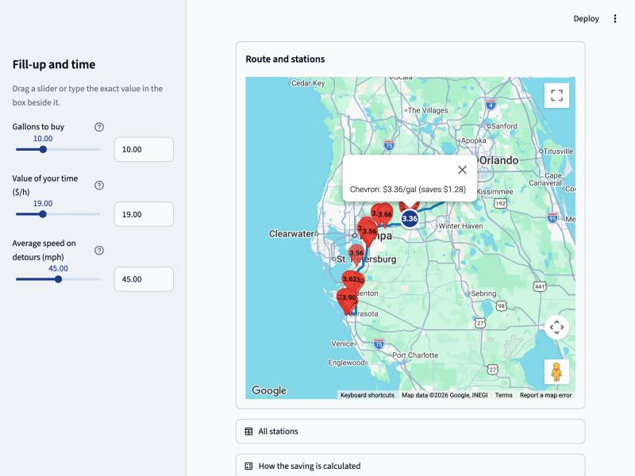
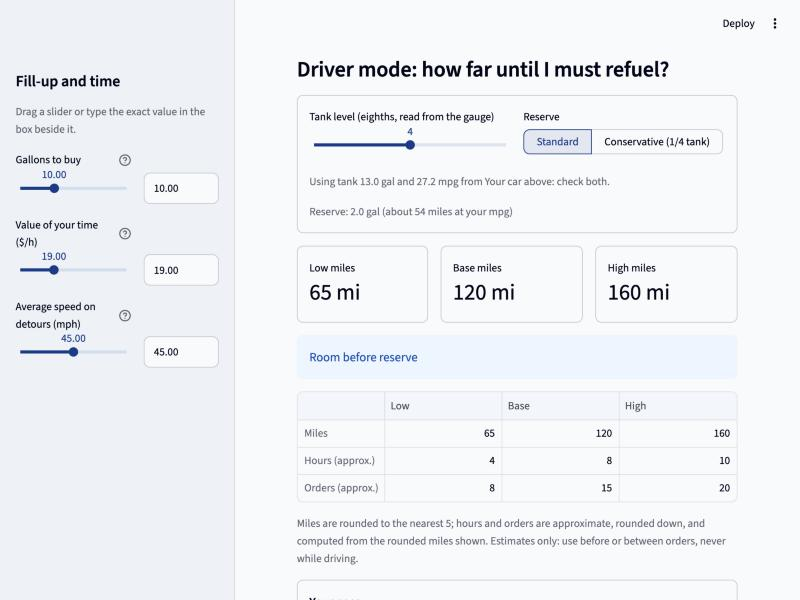

# Fuel Stop Planner — Project Report

**Programming for Data Science · Final Year-End Project**
Author: Gustavo Penna · Repository: https://github.com/gustavopennagiesb-ncf/fuel-stop-planner

> **TO FILL IN BEFORE SUBMITTING** — the two places marked `[...]` need your own words, and
> the "Team collaboration" section depends on whether this was approved as an individual
> project. Export this file to PDF or Word for the submission portal.

---

## 1. Objective

Drivers face two separate money questions and usually answer both by guessing: **when** to fill
up, and **where**. This project turns both into arithmetic the user can inspect.

The app answers three questions:

1. **Where should I stop on this route?** Not "which station is cheapest", but which one is
   cheapest *after* paying for the detour in fuel and time.
2. **Is this a good week to fill up?** Tested honestly against the naive forecast.
3. **How far can I drive before I must refuel?** Added for gig delivery drivers, who circle a
   city instead of travelling to a destination.

A deliberate constraint shaped the whole design: **the language model never produces a number.**
Every figure on screen is computed in Python; the model only phrases what the code already
calculated, and a validator checks it.

## 2. Data sources

Four external APIs, all returning JSON over HTTPS. Retrieval and parsing live in `providers/`,
one module per API, with no UI code.

| Source | Endpoint | What is read |
|---|---|---|
| EIA Open Data API v2 | `GET /v2/petroleum/pri/gnd/data/` | weekly regular gasoline, Florida and U.S.: `period`, `value` |
| Google Places API (New) | `POST /v1/places:searchNearby` | station `id`, name, coordinates, `fuelOptions.fuelPrices[]` |
| Google Routes API v2 | `POST /directions/v2:computeRoutes` | `distanceMeters`, `duration`, `polyline.encodedPolyline` |
| fueleconomy.gov (EPA/DOE) | `GET /ws/rest/vehicle/...` | EPA label mpg: `city08`, `comb08`, `highway08`, `fuelType` |
| Anthropic Messages API | `POST /v1/messages` | the explanatory text (no numbers trusted) |

The weekly EIA series is cached to `data/eia_weekly.csv` and reused when the API is unreachable.
Google responses are **never** written to disk: their terms allow storing only place IDs, which
is also why the synthetic test fixtures are generated rather than recorded.

The app runs in two modes. `fixture` needs no keys at all and generates synthetic data, clearly
labelled on screen; `google` uses the live APIs. Both Google calls send a field mask, so only
the fields above are requested and billed.

## 3. Exploratory data analysis


The Florida and U.S. weekly series cover **1,245 weeks** (2003 to 2026). The EDA tab reports the
cleaning rather than hiding it: **20 missing weeks** were filled by linear interpolation and
**19 price shocks** were flagged at a threshold the user can move (default: 3 standard
deviations of the weekly change). Outlier treatment is a choice offered to the user, "keep" or
"interpolate", because a price shock in gasoline is often a real event rather than an error.
The before/after means and standard deviations are printed so the effect of the treatment is
visible (mean 2.800 → 2.779, SD 0.651 → 0.668).

Weekly *changes* in Florida and U.S. prices correlate at **r = 0.799**, and the lead-lag analysis
puts the strongest link at **lag 0**: Florida moves with the national market in the same week,
not after it. That result matters for the forecasting question below, because it removes the
obvious candidate predictor.

## 4. Methodology and results

### 4.1 When to fill up: an honest negative result


Four methods were evaluated with **rolling-origin evaluation** against the naive forecast
("next week equals this week"), at horizons of 1, 2 and 4 weeks. Errors are reported as a ratio
to naive, so below 1.00 means better than naive.

| Method | h=1 | h=2 | h=4 |
|---|---|---|---|
| naive | 1.000 | 1.000 | 1.000 |
| drift | 1.010 | 1.004 | 0.999 |
| moving average (4) | 1.682 | 1.317 | 1.201 |
| seasonal naive (52) | 8.675 | 5.071 | 3.352 |

**Nothing beats naive at one week.** Drift ties it at four weeks (0.999), which is within noise.
The app states this plainly instead of dressing it up: weekly retail gasoline behaves close to a
random walk, so timing the week is not where the money is. This negative result is reported as a
finding, and it is what justifies putting the effort into the "where" half instead.

### 4.2 Where to stop: the cheapest station is often the wrong one


*The screenshot shows the same tab from an earlier fetch. Its station prices match the measured run below, but the detour and the reference price had moved, so its savings are quite different. Repeated runs give different figures because live prices and Routes detours move between fetches; that variability is a real property of the data.*

For each station found along the route corridor, the app computes the **net benefit**:

```
net benefit = gallons × (reference price − station price)
              − (extra miles ÷ mpg) × station price      ← fuel burned on the detour
              − value of time × extra minutes ÷ 60        ← the time the detour costs
```

The *reference price* is the median price of stations within 800 m of the route: what the same
fill-up costs without leaving the route. Exact detours come from the Routes API for the cheapest
candidates, using a `via` waypoint; the rest use an out-and-back estimate, and the table says
which was used for each row.

How often does price alone pick the wrong station? The app measures it. The same stations are
re-ranked across a grid of fill sizes (5 to 20 gallons) and values of time ($0 to $40/h), which
costs nothing because the ranking is pure math and makes no new API call. In the measured run
(2026-11-16; Sarasota to Orlando, 3 km corridor, 10 gallons, 27.2 mpg, $19/h, 45 mph; 85 stations
found in the corridor), price alone picked the wrong station in **15 of the 20 combinations
(75%)**. That is this route, these stations, on that date, not a general law.

The run itself shows how it happens. The reference price on the route was **$3.54/gal**. The
**recommended** stop was a Chevron at **$3.36/gal**, a detour of **0.4 miles / 3 minutes**, with a
net saving of **$0.79** (gross $1.80, minus $0.05 of fuel, minus $0.95 of time). The **cheapest**
gas on the route was a different Chevron at **$3.28/gal**, but its detour is **1.89 miles / 9.7
minutes**, so its net is **-$0.68**: stopping there *loses* money, and it ranks **#30** of the
priced stations. Choosing on price alone would have cost **$1.47** (the "regret"). The cheapest
station is not merely worse, it is a net loss. The app shows both, so the user can see the
trade-off instead of being told to trust a ranking. (Dollar figures are rounded; the parts are
computed from unrounded miles and minutes.)



### 4.3 Driver mode: range before the reserve



For delivery drivers there is no destination, so the question changes to range. From the tank
level read off the gauge in eighths, the app computes `(gallons now − reserve) × mpg` and
reports it as a **low / base / high band** (65 / 120 / 160 miles in the screenshot), converted
into hours of work and approximate orders.

The band is deliberate. A gauge read by eye is a range, not a point, and stop-and-go driving
burns more than the EPA label. Every default here is an **assumption, labelled as one in the
interface**: 15 miles per hour of work, 8 miles per order, a reserve of 15% of the tank, and mpg
factors of 0.85 and 1.10. Research into driver habits found no measured public figures for these,
so presenting a single confident number would have been dishonest.

### 4.4 LLM integration: the model may phrase, never calculate

The model receives a closed dictionary of pre-computed facts and is instructed to use only those
numbers. Its output then passes through `validate()`, which extracts every number from the text
and checks each against the facts within a rounding tolerance. If any number cannot be traced,
the app retries once and then falls back to a deterministic template.

This makes hallucination **measurable, not hypothetical**: the interface reports the share of
numbers that were traceable on the first attempt, the number of attempts, and whether the
fallback was used. A failed API call (wrong key, no credit, network) is reported on screen, so a
broken integration can never be mistaken for a working one.

`[TO FILL IN: once your Anthropic API key is active, run the three LLM features and record the
observed traceable-number rate here. This is the headline result for the LLM section.]`

## 5. Engineering

| | |
|---|---|
| Commits | 37 (2026-11-09 to 2026-11-15) |
| Application code | 2,161 lines across 22 modules |
| Test code | 2,093 lines across 20 files, **269 tests** |
| Dependencies | pinned exactly; Python 3.11+ |

The architecture keeps the arithmetic away from the interface: **18 of the 22 modules contain no
Streamlit code at all**, which is why the test suite runs in about a minute without a browser,
a network connection, or a single API key. UI behaviour is covered with Streamlit's `AppTest`.

Cost control was a design requirement, not an afterthought. Paid searches run only when the user
presses "Find stations", never on a keystroke; detour calls are capped and memoised for ten
minutes; and the address autocomplete manages its own billing session.

## 6. Limitations

- The forecasting result is negative: no method tested beats the naive forecast at one week.
- Driver mode's defaults are assumptions, not measurements. They are labelled as such throughout.
- The detour for most stations is an out-and-back approximation; only the cheapest candidates get
  an exact route, to cap API cost. As a result the measured share of wrong picks mixes two detour
  methods: exact Routes detours for the cheapest handful of priced stations, an out-and-back
  estimate for the rest.
- Station prices come from Google and can be stale; every price is editable in the interface.
- Fuel price data is Florida and U.S. only.

## 7. Team collaboration and lessons learned

`[TO FILL IN — this section must be your own words. Points worth covering: this was built as an
individual project (confirm this was approved, since the brief is written for teams); how you
used AI assistance and where you judged its output rather than accepting it; and the lessons
that actually cost you time — the Python 3.9 environment failure that led to pinning every
dependency, the silent fallbacks that hid real failures until they were made visible, and the
decision to report a negative forecasting result instead of overfitting a model to beat it.]`
